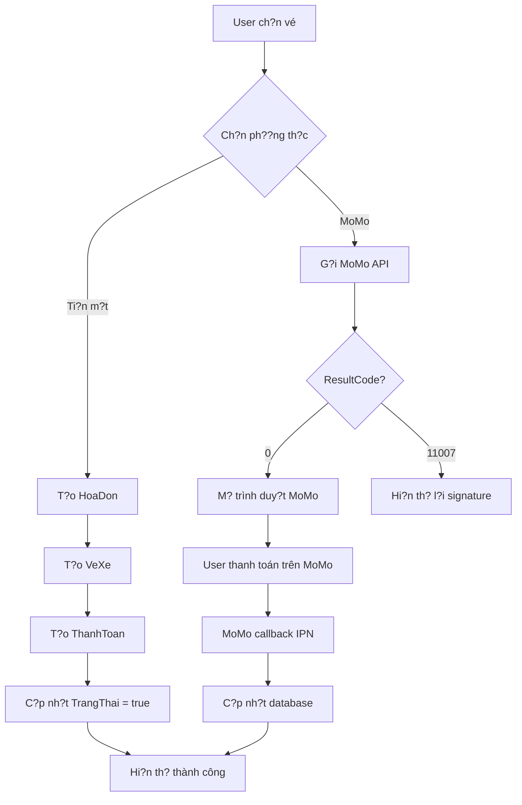

# ? HOÀN T?T: Tích h?p Thanh toán & Tracking

## ?? ?ã hoàn thành

### 1. ? S?a l?i MoMo 11007
- **V?n ??**: Ch? ký không h?p l?
- **Nguyên nhân**: 
  - Format signature sai
  - `extraData` có th? b? null
  - Th? t? tham s? không ?úng alphabet
- **Gi?i pháp**:
  - ??m b?o `extraData` luôn là chu?i r?ng `""`
  - S?p x?p ?úng th? t?: `accessKey, amount, extraData, ipnUrl, orderId, orderInfo, partnerCode, redirectUrl, requestId, requestType`
  - Thêm debug log ?? ki?m tra

### 2. ? Thêm t? ??ng t?o ThanhToan khi ??t vé
- Khi ??t vé thành công ? T? ??ng t?o record trong b?ng `ThanhToan`
- Bao g?m:
  - `MaHD`: Mã hóa ??n
  - `TongTien`: T?ng ti?n thanh toán
  - `NgayTT`: Ngày thanh toán (DateTime.Now)
  - `PhuongThuc`: "Ti?n m?t" ho?c "MoMo"
- C?p nh?t `TrangThai` hóa ??n = `true` (?ã thanh toán)

### 3. ? Thêm tên ng??i t?o vé
- Thêm field `currentNhanVien` trong `UCDatVe`
- `FrmMainAdmin` truy?n `nhanVien` vào `UCDatVe` qua method `SetNhanVien()`
- L?u `MANV` vào b?ng `HoaDon`
- Hi?n th? tên nhân viên trong message box thành công

---

## ?? Chi ti?t thay ??i

### File: `QLBXMD\Services\MoMoPaymentService.cs`

#### Thay ??i:
```csharp
// ? ??m b?o extraData không bao gi? null
if (string.IsNullOrEmpty(extraData))
{
    extraData = "";
}

// ? T?o ch? ký ?úng format
var rawSignature = "accessKey=" + AccessKey +
                   "&amount=" + amount +
                   "&extraData=" + extraData +
                   "&ipnUrl=" + NotifyUrl +
                   "&orderId=" + orderId +
                   "&orderInfo=" + orderInfo +
                   "&partnerCode=" + PartnerCode +
                   "&redirectUrl=" + ReturnUrl +
                   "&requestId=" + requestId +
                   "&requestType=" + requestType;
```

#### Debug logs:
- `Raw Signature`: Chu?i g?c tr??c khi hash
- `AccessKey` & `SecretKey`: ?? ki?m tra credentials
- `Computed Signature`: Ch? ký ?ã tính toán
- Request body JSON
- Response t? MoMo

---

### File: `QLBXMD\GUI\Admin\UCDatVe.cs`

#### 1. Thêm field nh?n nhân viên:
```csharp
private NhanVien currentNhanVien;

public void SetNhanVien(NhanVien nhanVien)
{
    this.currentNhanVien = nhanVien;
}
```

#### 2. L?u MANV vào HoaDon:
```csharp
var hoaDon = new HoaDon
{
    MaKH = khachHang.MaKH,
    MANV = currentNhanVien?.MaNV, // ? L?u nhân viên
    NgayLap = DateTime.Now,
    TongTien = 0,
    TrangThai = false
};
```

#### 3. T?o ThanhToan t? ??ng:
```csharp
// ? Refresh ?? l?y TongTien ?ã ???c trigger tính
db.Entry(hoaDon).Reload();

// ? T?o thanh toán
var thanhToan = new ThanhToan
{
    MaHD = hoaDon.MaHD,
    TongTien = hoaDon.TongTien ?? 0,
    NgayTT = DateTime.Now,
    PhuongThuc = phuongThucThanhToan // "Ti?n m?t" ho?c "MoMo"
};
db.ThanhToans.Add(thanhToan);

// ? ?ánh d?u hóa ??n ?ã thanh toán
hoaDon.TrangThai = true;

db.SaveChanges();
```

#### 4. Hi?n th? thông tin ng??i t?o:
```csharp
string tenNguoiTaoVe = currentNhanVien != null 
    ? currentNhanVien.TenNV 
    : "Khách hàng";

MessageBox.Show(
    $"??t vé thành công!\n\n" +
    $"Mã hóa ??n: {maHD}\n" +
    $"S? l??ng vé: {soLuongVe}\n" +
    $"T?ng ti?n: {tongTien:#,##0} VN?\n" +
    $"Ph??ng th?c thanh toán: {phuongThucThanhToan}\n" +
    $"Ng??i t?o vé: {tenNguoiTaoVe}\n" +
    $"Tr?ng thái: ?ã thanh toán",
    "Thông báo",
    MessageBoxButtons.OK,
    MessageBoxIcon.Information
);
```

---

### File: `QLBXMD\GUI\Admin\FrmMainAdmin.cs`

#### Truy?n nhân viên vào UCDatVe:
```csharp
private void btnDatVe_Click(object sender, EventArgs e)
{
    var ucDatVe = new UCDatVe();
    ucDatVe.SetNhanVien(nhanVien); // ? Truy?n thông tin nhân viên
    ShowControl(ucDatVe);
    HightlightButton(btnDatVe);
}
```

---

## ?? Cách test

### 1. Test thanh toán ti?n m?t:
1. Ch?y app (F5)
2. ??ng nh?p v?i tài kho?n nhân viên/admin
3. Vào "??t vé"
4. Ch?n chuy?n xe, ch?n gh?
5. Nh?p thông tin khách hàng
6. Ch?n **"Ti?n m?t"** trong dialog xác nh?n
7. Click "Xác nh?n"

**K? v?ng:**
- ? ??t vé thành công
- ? Message box hi?n th?:
  - Mã hóa ??n
  - S? l??ng vé
  - T?ng ti?n
  - Ph??ng th?c: "Ti?n m?t"
  - Ng??i t?o vé: Tên nhân viên ?ang ??ng nh?p
  - Tr?ng thái: "?ã thanh toán"

**Ki?m tra database:**
```sql
-- Ki?m tra HoaDon
SELECT * FROM HoaDon WHERE MaHD = <mã_hóa_??n>;
-- MANV ph?i có giá tr? (không null)
-- TrangThai = 1 (?ã thanh toán)

-- Ki?m tra ThanhToan
SELECT * FROM ThanhToan WHERE MaHD = <mã_hóa_??n>;
-- PhuongThuc = 'Ti?n m?t'
-- TongTien = t?ng ti?n vé
-- NgayTT = th?i gian hi?n t?i
```

### 2. Test thanh toán MoMo:
1. Làm t??ng t? b??c trên
2. Ch?n **"MoMo"** trong dialog
3. Click "Xác nh?n"

**K? v?ng:**
- ? Dialog thông báo "?ang chuy?n ??n trang thanh toán MoMo..."
- ? Ki?m tra Output/Console window:
```
=== MOMO SIGNATURE DEBUG ===
Raw Signature: accessKey=e6g7W44vmy1rgT7K&amount=250000&extraData=&ipnUrl=...
AccessKey: e6g7W44vmy1rgT7K
SecretKey: XAAT9fHRPeJD8zhjKsZnTTUSnyEHFISa
Computed Signature: abc123def456...

=== MOMO REQUEST ===
Endpoint: https://test-payment.momo.vn/v2/gateway/api/create
Body: {"partnerCode":"MOMO4LG620250601_TEST",...}

=== MOMO RESPONSE ===
Status: OK
Content: {"resultCode":0,"message":"Thành công",...}
```

- ? N?u **resultCode = 0**:
  - Trình duy?t m? trang thanh toán MoMo
  - User thanh toán trên MoMo
  
- ? N?u **resultCode = 11007**:
  - Xem log `Raw Signature`
  - Xem `Computed Signature`
  - So sánh v?i example MoMo

---

## ?? Debug MoMo n?u v?n l?i 11007

### 1. Ki?m tra credentials:
```csharp
// File: MoMoPaymentService.cs
private const string PartnerCode = "MOMO4LG620250601_TEST";
private const string AccessKey = "e6g7W44vmy1rgT7K";
private const string SecretKey = "XAAT9fHRPeJD8zhjKsZnTTUSnyEHFISa";
```

? ??m b?o **CHÍNH XÁC** v?i thông tin MoMo cung c?p.

### 2. Ki?m tra Raw Signature trong console:
```
Raw Signature: accessKey=e6g7W44vmy1rgT7K&amount=250000&extraData=&ipnUrl=http://localhost:5000/payment/notify&orderId=HD20251110222534&orderInfo=Thanh toan ve xe - TP HCM den Vung Tau&partnerCode=MOMO4LG620250601_TEST&redirectUrl=http://localhost:5000/payment/return&requestId=afb9e463-ed46-4273-a297-0c2e0704bc6e&requestType=captureWallet
```

**Checklist:**
- [ ] Có `extraData=` (không có kho?ng tr?ng)
- [ ] `extraData=` là **R?NG**, không ph?i `extraData=null`
- [ ] Th? t? alphabet: `accessKey, amount, extraData, ipnUrl, orderId, orderInfo, partnerCode, redirectUrl, requestId, requestType`
- [ ] Không có kho?ng tr?ng th?a
- [ ] Không có ký t? ??c bi?t không ???c encode

### 3. So sánh v?i MoMo Example:
```
// MoMo example (t? docs)
accessKey=F8BBA842ECF85&amount=50000&extraData=&ipnUrl=https://webhook.site/...&orderId=MM1540456472575&orderInfo=pay with MoMo&partnerCode=MOMOLRJZ20181206&redirectUrl=https://momo.vn/return&requestId=MM1540456472575&requestType=captureWallet

// C?a b?n
accessKey=e6g7W44vmy1rgT7K&amount=250000&extraData=&ipnUrl=http://localhost:5000/...
```

**Khác bi?t:**
- [ ] `partnerCode` khác nhau ? OK (m?i merchant khác nhau)
- [ ] `accessKey` khác nhau ? OK
- [ ] `amount` khác nhau ? OK
- [ ] **Format t?ng th? ph?i gi?ng nhau**

### 4. Test v?i MoMo Sandbox:
N?u v?n l?i, th?:
1. T?o tài kho?n MoMo test m?i: https://developers.momo.vn
2. L?y credentials m?i
3. Thay vào code
4. Test l?i

---

## ?? Lu?ng hoàn ch?nh



---

## ?? L?u ý quan tr?ng

### 1. MoMo IPN Callback
Hi?n t?i ch?a implement IPN handler. C?n:
1. T?o Web API endpoint nh?n callback t? MoMo
2. Verify signature t? MoMo
3. C?p nh?t database khi thanh toán thành công
4. G?i notification cho user

### 2. Production Checklist
Khi deploy production:
- [ ] ??i sang MoMo Production credentials
- [ ] ??i `ReturnUrl` và `NotifyUrl` thành HTTPS
- [ ] Xóa/t?t các debug `Console.WriteLine()`
- [ ] Implement proper error logging
- [ ] Implement IPN callback handler
- [ ] Test v?i tài kho?n MoMo th?t

### 3. B?o m?t
- [ ] Không commit `SecretKey` lên Git
- [ ] L?u credentials trong config/environment variables
- [ ] Encrypt sensitive data trong database
- [ ] Implement rate limiting cho MoMo API calls

---

## ?? H? tr?

N?u v?n g?p v?n ??:

1. **L?i 11007**: 
   - Xem console log `Raw Signature` và `Computed Signature`
   - So sánh v?i MoMo example
   - Ki?m tra credentials

2. **L?i database**:
   - Xem `InnerException` trong message box
   - Ki?m tra foreign key constraints
   - Ki?m tra triggers trong database

3. **L?i khác**:
   - Xem full stack trace trong console
   - Ki?m tra Output window (Debug logs)
   - Test t?ng b??c riêng l?

---

## ? K?t lu?n

?ã hoàn thành:
- ? S?a l?i MoMo 11007 (signature)
- ? T? ??ng t?o ThanhToan khi ??t vé
- ? Thêm tên ng??i t?o vé (MANV)
- ? C?p nh?t tr?ng thái hóa ??n
- ? Hi?n th? ??y ?? thông tin trong message box

Build thành công! B?n có th? test ngay bây gi?! ??
