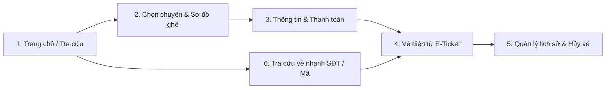

# Checklist Phát Triển Hệ Thống Đặt Vé Khách Hàng (Customer Booking System)

Hệ thống bán vé xe trực tuyến Bến xe Miền Đông Mới — CoachBooking Platform.

---

## 1. Phân Tích Luồng Nghiệp Vụ Khách Hàng (Customer User Journey)

---

## 2. Danh Sách Tính Năng & Checklist Triển Khai

### Giai đoạn 1: Khung Giao Diện Khách Hàng (Customer Layout & Navigation)
- [x] Tách `CustomerLayout` riêng biệt khỏi `AppLayout` của Quản trị viên (loại bỏ sidebar admin khi khách đặt vé).
- [x] Thanh điều hướng khách hàng: Logo BX Miền Đông, Trang chủ, Lịch trình xe, Tra cứu vé, Vé của tôi, Hồ sơ cá nhân, Đăng nhập / Đăng xuất.
- [x] Footer chuyên nghiệp chuẩn Bến xe Miền Đông Mới (SAMCO): Hotline 1900 6067, địa chỉ bến, quy định hành lý, chính sách hủy vé.
- [x] Thanh hiển thị tiến trình đặt vé (Booking Stepper Bar):
  - Bước 1: Chọn chuyến xe
  - Bước 2: Chọn vị trí ghế & Điểm đón/trả
  - Bước 3: Thông tin hành khách & Thanh toán
  - Bước 4: Nhận vé điện tử (E-Ticket)

---

### Giai đoạn 2: Tìm Kiếm & Lọc Chuyến Nâng Cao (Trip Search & Filter)
- [x] Hỗ trợ bộ lọc chuyến thông minh:
  - Lọc theo khung giờ xuất bến: Sáng sớm (00:00 - 06:00), Buổi sáng (06:00 - 12:00), Buổi chiều (12:00 - 18:00), Buổi tối (18:00 - 24:00).
  - Lọc theo nhà xe đối tác (Phương Trang, Thành Bưởi, Hoàng Long, Mai Linh, Kumho Samco,...).
  - Lọc theo dòng xe (Limousine cao cấp, Giường nằm 2 tầng, Ghế ngồi tiêu chuẩn).
  - Lọc theo khoảng giá vé (Min - Max slider/chips).
- [x] Sắp xếp danh sách chuyến: Giờ chạy sớm nhất, Giá vé tăng/giảm, Số ghế trống nhiều nhất.
- [x] Thẻ chuyến xe (Trip Card) chi tiết:
  - Timeline điểm đi - điểm đến với thời gian dự kiến.
  - Tên nhà xe, loại xe, biển số xe, tên tài xế.
  - Số chỗ còn trống (cảnh báo màu cam nếu còn dưới 5 chỗ).
  - Tiện ích đi kèm: Wifi bến xe, Nước suối khăn lạnh, Bảo hiểm hành khách.

---

### Giai đoạn 3: Chọn Ghế & Điểm Đón/Trả Trực Quan (Interactive Seat Selection)
- [x] Sơ đồ ghế 2 tầng (Tầng 1 - Dưới / Tầng 2 - Trên) với cabin và biểu tượng vô lăng tài xế trực quan.
- [x] Trạng thái ghế rõ ràng theo mã màu:
  - Ghế trống (Trắng viền xám)
  - Ghế đang chọn (Cam nổi bật)
  - Ghế đã bán / Đã giữ chỗ (Xám nhạt có gạch chéo / icon khóa)
- [x] Chọn điểm đón khách: Tại Bến xe Miền Đông Mới hoặc các trạm trung chuyển được ủy quyền.
- [x] Chọn điểm trả khách tại bến đến.
- [x] Bảng tóm tắt vé nổi bên phải (Sticky Booking Summary Sidebar):
  - Tuyến xe, thời gian xuất bến.
  - Danh sách ghế đang chọn (A01, A02,...).
  - Đơn giá, phụ thu (nếu có), bảo hiểm hành khách.
  - Tổng số tiền cần thanh toán cập nhật theo thời gian thực.

---

### Giai đoạn 4: Thanh Toán & Giữ Chỗ (Checkout & Payment Confirmation)
- [x] Form thông tin hành khách:
  - Họ và tên hành khách đi xe.
  - Số điện thoại nhận tin nhắn SMS / Zalo vé.
  - Email nhận vé điện tử PDF.
  - Ghi chú thêm cho nhà xe.
- [x] Đồng hồ đếm ngược thời gian giữ chỗ tạm thời (15 phút) để hành khách thanh toán.
- [x] Hỗ trợ đa dạng phương thức thanh toán:
  - **Chuyển khoản VietQR**: Tạo mã QR ngân hàng kèm cú pháp nội dung chuyển khoản tự động (Mã hóa đơn).
  - **Thanh toán sau (Giữ chỗ 24h)**: Dành riêng cho tài khoản khách hàng, có hạn thanh toán trước khi khởi hành.
  - **Tiền mặt tại quầy**: Xuất trình mã hóa đơn tại quầy vé Bến xe Miền Đông Mới trước 60 phút.
  - **Thẻ ATM / Thẻ ghi nợ nội địa**.
- [x] Điều khoản dịch vụ và chính sách hủy vé bắt buộc tích chọn trước khi bấm thanh toán.

---

### Giai đoạn 5: Vé Điện Tử (E-Ticket / Boarding Pass Voucher)
- [x] Giao diện **Vé điện tử (E-Ticket)** chuyên nghiệp:
  - Mã đặt chỗ (Booking Code / Invoice Code #HD...).
  - Mã QR Code vé dùng để nhân viên soát vé quét trực tiếp tại cửa xe.
  - Chi tiết hành trình: Ngày đi, giờ xuất bến, giờ đến dự kiến, tuyến xe.
  - Chi tiết vận hành: Nhà xe, Biển số xe, Tên tài xế, Cửa ra xe (Gate / Platform).
  - Chi tiết vị trí: Danh sách số ghế đã đặt.
  - Trạng thái thanh toán (Đã thanh toán / Giữ chỗ chưa thanh toán).
- [x] Tiện ích vé điện tử:
  - Nút **In vé (Print E-Ticket)** với định dạng in đẹp mắt chuẩn khổ A4/A5, ẩn các nút bấm thừa.
  - Nút **Lưu ảnh vé / Tải PDF** để hành khách lưu trên điện thoại.
  - Hướng dẫn lên xe tại Bến xe Miền Đông Mới (có mặt trước 30 phút, cửa đón khách).

---

### Giai đoạn 6: Quản Lý Lịch Sử Đặt Vé & Hủy Vé Trực Tuyến (Customer Ticket History)
- [x] Giao diện quản lý vé cá nhân dành cho khách hàng:
  - Tab 1: **Chuyến đi sắp tới (Upcoming)** — hiển thị các vé xe chuẩn bị đi.
  - Tab 2: **Lịch sử chuyến đi (Completed / Cancelled)** — xem lại các chuyến đã qua.
- [x] Nút "Xem vé điện tử" cho từng chuyến.
- [x] Nút "Thanh toán ngay" cho các hóa đơn ở trạng thái giữ chỗ (chưa thanh toán).
- [x] Tính năng **Hủy vé trực tuyến (Cancel Ticket)**:
  - Kiểm tra điều kiện hủy vé: Chỉ được hủy vé trước giờ xe chạy ít nhất 2 tiếng và vé đã thanh toán.
  - Modal xác nhận hủy vé hiển thị rõ số tiền hoàn lại (theo quy định khấu trừ của bến).
  - Cập nhật trạng thái vé và giải phóng ghế tức thì trên hệ thống.

---

### Giai đoạn 7: Tra Cứu Vé Nhanh Dành Cho Khách Không Đăng Nhập (Guest Ticket Lookup)
- [x] Màn hình tra cứu vé công khai (`/lookup` hoặc `/tra-cuu-ve`):
  - Người dùng chỉ cần nhập: **Mã hóa đơn / Mã vé** + **Số điện thoại đặt vé**.
  - Không yêu cầu đăng nhập tài khoản.
- [x] Backend API:
  - `POST /api/invoices/lookup` nhận `{ invoiceId, phone }` hoặc `{ ticketId, phone }` và trả về `InvoiceDetail` nếu khớp số điện thoại.
- [x] Hiển thị trực tiếp thẻ Vé điện tử (E-Ticket) với đầy đủ mã QR và nút In vé / Lưu vé.

---

## 3. Kế Hoạch Thiết Kế Bằng Stitch MCP (UI Design Plan)

Sử dụng Stitch MCP server với Project ID: `projects/6856564930346291109` ("CoachBooking - Customer Booking"):

| STT | Tên màn hình Stitch | Mục đích thiết kế |
| --- | --- | --- |
| 1 | `CoachBooking - Tìm kiếm & Lọc chuyến xe (Search & Filter)` | Thiết kế layout 2 cột: Cột trái bộ lọc giờ, nhà xe, giá; Cột phải danh sách chuyến xe kèm timeline và nút chọn ghế. |
| 2 | `CoachBooking - Đặt vé & Chọn ghế 2 tầng (Seat Selection & Booking)` | Sơ đồ xe giường nằm 2 tầng cabin, chọn điểm đón/trả, sidebar tóm tắt vé cố định (Sticky Sidebar). |
| 3 | `CoachBooking - Thanh toán & Xác nhận đơn hàng (Checkout & Payment)` | Form thông tin khách, chuyển khoản VietQR, tiền mặt, thẻ ATM, đồng hồ đếm ngược giữ chỗ 15 phút. |
| 4 | `CoachBooking - Vé điện tử E-Ticket & Xác nhận thành công (E-Ticket Confirmation)` | Thẻ vé Boarding pass sang trọng với mã QR, cổng xuất bến, thông tin tài xế/xe, nút In vé và Tải vé. |
| 5 | `CoachBooking - Lịch sử vé & Quản lý chuyến đi (Customer Ticket History)` | Giao diện portal khách hàng với tab Chuyến sắp đi, Lịch sử, nút xem vé, thanh toán và hủy vé online. |
| 6 | `CoachBooking - Tra cứu vé nhanh (Public Ticket Lookup)` | Giao diện tra cứu vé công khai bằng SĐT và Mã vé. |

---

## 4. Kế Hoạch Kiểm Thử & Nghiệm Thu (Verification Plan)

- [x] **Kiểm thử tự động Backend**:
  - `.\gradlew.bat test`: Kiểm thử toàn bộ controller, service, repository, logic hủy vé và tra cứu (BUILD SUCCESSFUL).
  - `.\gradlew.bat spotlessCheck`: Kiểm tra định dạng chuẩn Google Java Format (BUILD SUCCESSFUL).
- [x] **Kiểm thử tự động Frontend**:
  - `npm run build`: Kiểm thử biên dịch TypeScript và đóng gói Vite không có lỗi (0 errors, 808ms).
- [ ] **Kiểm thử luồng nghiệp vụ thực tế (End-to-End User Flow)**:
  1. Người dùng tìm chuyến xe từ TP HCM đi Đà Lạt hoặc Vũng Tàu.
  2. Chọn chuyến, mở sơ đồ ghế, chọn 2 ghế tầng 1.
  3. Nhập thông tin hành khách, chọn phương thức thanh toán chuyển khoản / thanh toán sau.
  4. Hoàn tất đặt vé, màn hình hiển thị Thẻ vé điện tử (E-Ticket) có mã QR code.
  5. Thử nút In vé điện tử xem giao diện in có chuẩn không.
  6. Vào mục Lịch sử đặt vé, kiểm tra thấy hóa đơn vừa đặt; thử thanh toán hoặc hủy vé.
  7. Vào trang Tra cứu vé, nhập mã vé + SĐT để kiểm tra tra cứu không cần đăng nhập.
